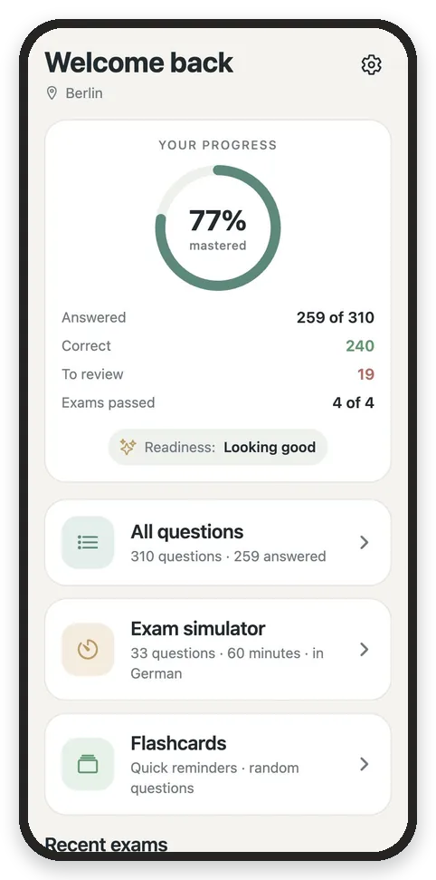
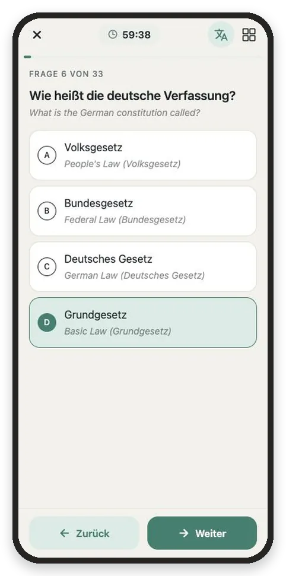
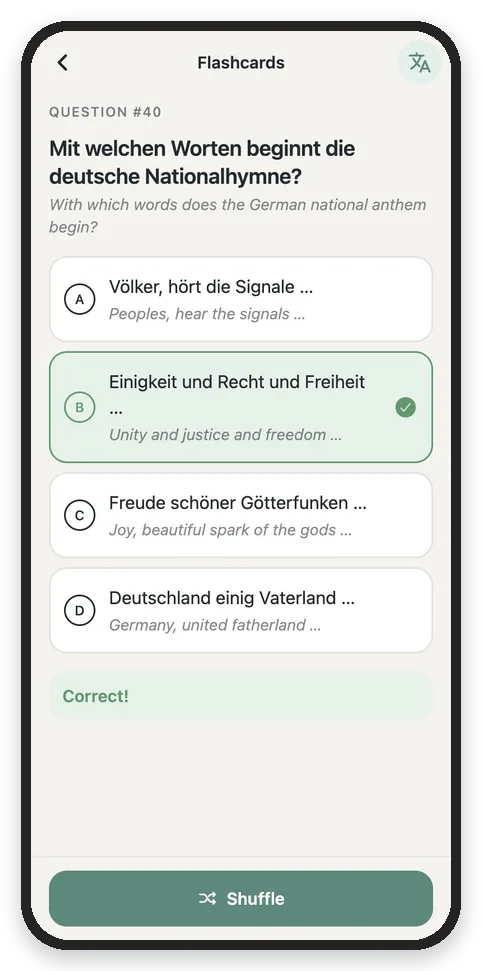
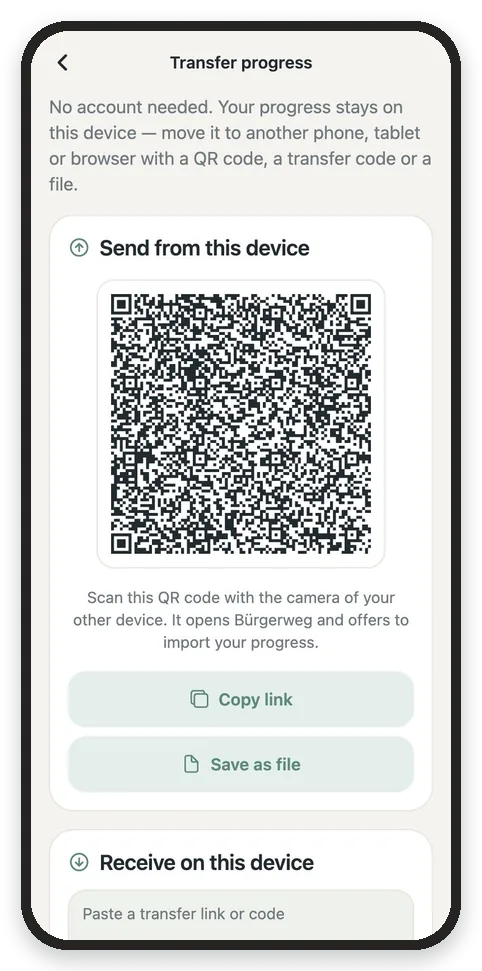

# Bürgerweg

**Calm, free and private practice for the German citizenship test** (*Einbürgerungstest* / *Leben in Deutschland*).
No account, no tracking, works offline. Interface in English and German.

<p>
  
  
  
  
</p>

## Features

- **All questions**: the 300 general questions plus the 10 for your federal state, from the official BAMF catalog
  (as of 7 May 2025), including all 43 picture questions. Search and filters.
- **Exam simulator**: 33 questions, 60 minutes, pass with 17, just like the real test. Always in German, with an
  optional translation shown quietly *under* the German text.
- **Flashcards**: one random question at a time, instant feedback, Shuffle.
- **Progress**: mastery ring, stats, exam history and a readiness hint.
- **Account-free transfer**: progress becomes a short link (QR code, copy or file). Scan it with any phone camera to
  continue on another device. The data travels in the URL fragment, so it never reaches a server.

## Platforms

| Platform | How |
| --- | --- |
| Any browser | Phones, tablets and computers: landing page at `/`, app at `/app/`, nothing to download |
| iPhone / iPad | Install as an app (PWA): Safari → Share → *Add to Home Screen* |
| Android | Install as an app (PWA): Chrome menu → *Install app*, or the native app via **F-Droid** (planned; no Google dependencies) |
| Computer | Install as an app (PWA) in Chrome or Edge, from the install icon in the address bar |

Everything is free to host (any static host) and free to use.

## Quick start

```bash
npm install
npm run web             # develop in the browser (app served at http://localhost:8081/app)
npm run typecheck
```

Build the deployable website (landing page and PWA):

```bash
SITE_URL=https://astanov.com/burgerweg npm run build:site
npm run serve:site      # preview ./site at http://localhost:8090/burgerweg/
```

Build the Android release APK (needs the Android SDK and JDK 17):

```bash
npm run android:release # → android/app/build/outputs/apk/release/app-release.apk
```

## Documentation

Start with **[docs/README.md](docs/README.md)**. The specification is [docs/SPEC.md](docs/SPEC.md); there are
also docs for the architecture, question data, transfer, deployment, F-Droid and branding.

## Project layout

```
src/app/        screens (Expo Router)          landing/      static SEO landing page (de, en)
src/lib/        state, i18n, questions, …      public/       PWA manifest, service worker, icons
src/data/       generated question data        fastlane/     F-Droid store listing (de, en)
assets/         icons, question images         fdroid/       draft F-Droid build recipe
scripts/        data pipeline, site build      docs/         documentation
```

## Contributing

Help is very welcome, especially **checking answers** and **improving translations**. See
[CONTRIBUTING.md](CONTRIBUTING.md).

## License

Code: [MIT](LICENSE). The question catalog comes from the BAMF, and five catalog photos belong to third parties.
See [NOTICE.md](NOTICE.md). Bürgerweg is an independent project, not affiliated with the BAMF; translations and the
answer key are unofficial.
